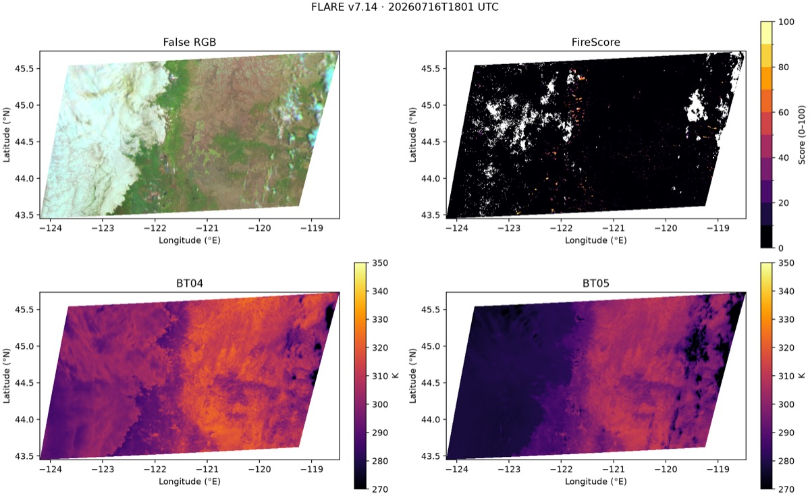

# FLARE Oregon sample — FireScore v7.14

Developed by **BRIDGE Research and Policy Foundation** and **ARTH GEO Intelligence**.

25 experimental scenes for July 16, 2026: **17:41–18:41** and **19:21–20:16 UTC**,
at five-minute intervals. The gap is intentional. Each scene contains 545 × 1,425
native pixels. The curved footprint spans approximately 43.453–45.734°N and
124.198–118.469°W; these extrema describe the footprint, not a rectangular mask.



Repository: [ManjuSmriti/flare-oregon-sample](https://github.com/ManjuSmriti/flare-oregon-sample).

## Get the data

Data publication is being prepared. No GitHub release URL or Zenodo DOI has yet been
assigned. Download the relevant archives when available and extract them into
`data/` in this repository. Alternatively, set `FLARE_DATA_DIR` to the existing
folder containing `Zarr/`, `NETCDF/`, and/or `Tiles/`.

| Download | Contents |
|---|---|
| flare-v7.14-oregon-zarr.zip | All 25 scientific scenes, Zarr v2 |
| flare-v7.14-oregon-netcdf.zip | Same values, 25 NetCDF4 files |
| flare-v7.14-oregon-tiles.zip | Indexed map tiles and local comparison viewer |

Each archive includes the supplied README and validation metadata. Release
`SHA256SUMS.txt` verifies the download archives; the original per-file manifest
is included separately. Zarr and NetCDF preserve full source precision. Tiles
round brightness temperatures to whole kelvin and FireScore to whole numbers.

## Run the examples

Python 3.11 or 3.12 is recommended.

```sh
python -m venv .venv
source .venv/bin/activate  # Windows: .venv\Scripts\activate
python -m pip install -r requirements.txt
jupyter lab
```

Open the notebooks in order:

1. `notebooks/01_open_and_validate.ipynb`: inspect metadata and compare formats.
2. `notebooks/02_false_rgb_and_maps.ipynb`: select a scene, generate RGB, and
   explore geographic FireScore/temperature panels and a zoomable HTML map.
3. `notebooks/03_pixel_time_series.ipynb`: choose a location, find its native
   pixel, and compare temperatures, score, and observation quality over time.

The notebooks have an editable data-folder setting. Use `FLARE_DATA_DIR` for
automation. All timestamps are UTC. Figures go to `outputs/`.

Python users can also run:

```sh
python examples/flare_sample.py --data ./data --tag 20260716T1741 --output outputs
```

For the original three-source viewer, extract all three archives into the
same data folder and run `python data/Tiles/serve.py`, then visit
`http://127.0.0.1:8774/`. This Python server must run locally or on a suitable
host; GitHub Pages cannot execute it. Basemaps and browser mapping libraries
require internet. Static scientific plots work offline.

## Variables and interpretation

`I01`–`I05`, `BT04`, `BT05`, `lat`, `lon`, `FireScore`,
`ObservationConfidence`, `AtmosphereState`, and scalar `time`.

- I01–I05 and temperatures are reconstructed/inferred, not direct VIIRS measurements.
- Radiance physical units remain unverified; the examples do not infer units or convert to reflectance.
- BT04 and BT05 are in kelvin. FireScore is an experimental 0–100 engineering score, not a probability.
- ObservationConfidence describes observation quality, not confidence that fire exists.
- Floating NaN is unavailable. Valid score zero and categorical zero are retained.
- Atmospheric codes: 0 unknown, 1 clear, 2 cloud, 3 smoke, 4 conflict, 5 unresolved.
- Quality codes: 0 missing, 1 obscured/unreliable/water, 2 cloud/edge risk,
  3 usable with uncertain atmosphere, 4 clear.

False RGB uses I03/I02/I01 in R/G/B, with fixed 0–0.6 stretch and gamma 2.2,
matching this package's viewer. It differs from the earlier percentile-stretched
cover image. Native two-dimensional latitude/longitude are used for geographic
plots. Web overlays are resampled to Web Mercator before placing on a basemap.

## Validation and licensing

The pre-release audit checked 6,482 original file checksums, exact equality of
all Zarr/NetCDF scenes, source crop alignment for all 25 scenes, and 10,300
numeric tiles against the bundled lookup. Tile temperature/score rounding errors
are at most 0.5; categories match exactly.

Data and documentation: **CC BY-NC-ND 4.0**, see `LICENSE`.
Examples and notebooks use the same requested license. CC licenses are not
usually recommended for software; a separate software license can be selected
by the owners before publication. No additional data rights are implied.
