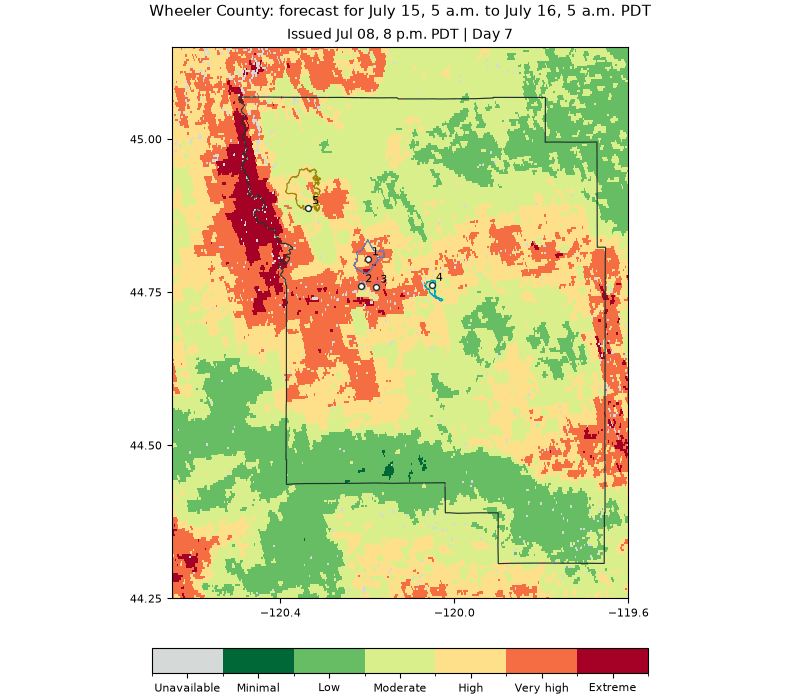

# July 15 FireOutlook: seven evening updates

**Keep the forecast target fixed on July 15, 2026, and follow the guidance from
July 8 through July 14 at 8 p.m. PDT.** This is the sequence in the Wheeler County
presentation, from Day 7 to Day 1.

**[Open the executed notebook](../notebooks/04_seven_day_outlook.ipynb).** Install
`outlook/requirements.txt` and run all cells to reproduce the maps, animation,
county statistics, five fire-location comparisons, and CSV exports. The sample
and reference geography are bundled; no separate download is needed.



The issue date advances from July 8 to July 14 PDT while the target stays July 15.

## Dates and leads

Every forecast covers **July 15, 5 a.m. to July 16, 5 a.m. PDT**, or July 15
12:00 to July 16 12:00 UTC. The end is exclusive.

| Issued at 8 p.m. PDT | Issued at 03:00 UTC | Lead | Weather |
| --- | --- | --- | --- |
| July 8 | July 9 | Day 7 | NBM |
| July 9 | July 10 | Day 6 | NBM |
| July 10 | July 11 | Day 5 | NBM |
| July 11 | July 12 | Day 4 | NBM |
| July 12 | July 13 | Day 3 | NBM |
| July 13 | July 14 | Day 2 | NBM |
| July 14 | July 15 | Day 1 | HRRR |

The July 8 **UTC** issuance would need Day 8 to cover this target. The July 8
**PDT evening** issuance is July 9 UTC and covers it at Day 7.

## Included data

`wheeler_target_20260715.nc` contains seven issue-time rows, each with its selected
lead for the same target. Forecast fields have dimensions `issue_time, y, x`;
`forecast_day[issue_time]` runs from 7 down to 1. This is a native-grid window
containing Wheeler County, not the full western-domain archive.

Original index, stored categories, quality flags, coordinates, pixel area,
weather cycles and completion markers are retained. The exporter compares every
exported array with its source, including NaNs. It performs no resampling.
`manifest.json` records source issue signatures, grid window, and checksums.

The original July product is **FireOutlook2.0-hrrr1-nbm2to7-1**. Days 2-7 remain
experimental. It uses NBM on Day 2; the later hybrid operational policy is a
different version. Vegetation, snow support and the prior are frozen for each
issuance, so each new row can incorporate new pre-issue inputs.

## Maps and comparisons

Seven maps and an animation hold geography and target dates fixed. Reference
origins and July 16-17 observed outlines show Crosswhite, Red Rock, Twickenham,
Camel Hump and Cove Creek. These are observed reference geometries, not forecast
fire boundaries. The notebook calculates the same nearest-pixel samples across
all seven updates.

County High-or-above percentages use stored categories >=4, weighted by source
geodesic pixel area. The denominator includes **all county pixel centers**, even
unavailable ones. A center-in-polygon test approximates boundary coverage.
This matches the presentation's method and measures forecast danger area, not
burned area. The notebook also reports the scored percentage.

## Categories and quality

Codes 1-6 are Minimal, Low, Moderate, High, Very high and Extreme. Code 0 is
Unavailable. Use stored categories and the file's `category_edges`, not rounded
thresholds from earlier story displays. An index value of zero can be valid.
The index is an engineering indicator rather than a calibrated probability.

Flags can coexist: 1 excluded land; 2 no paired vegetation donor; 4 missing trend;
8 missing weather; 16 historical vegetation donor; 32 NIFC proximity prior
applied; 64 experimental longer lead. Read only completed forecasts.

This historical forecast replay illustrates changing guidance. It does not by
itself establish predictive skill or forecast ignition and spread. The retained
experiment audit verified pre-issue weather publication and vegetation times;
historical prior receipt times were not fully verified. The reference fire
records are used here for interpretation after forecast generation.

## Reproducibility and sources

The notebook is generated by `examples/build_seven_day_notebook.py`. Run tests
from the repository root with:

```bash
python -m unittest discover -s outlook/examples -p test_seven_day.py
```

To rebuild the sample from your own copy of the archive, install `zarr>=2.18,<3`
and use `examples/export_seven_day_sample.py` with four arguments: archive path,
county GeoJSON, original five NIFS reference records, and destination NetCDF.
The full operational archive is not bundled. The exporter fixes the target and
source grid window to this example and validates every selected lead.

County boundary: US Census TIGERweb, BAS 2026; source URL retained in
`references.geojson`. Origins and outlines: retained NIFC/WFIGS NIFS history,
July 16-17, 2026; IRWIN identifiers and record timestamps are retained.

Creator: **Manju Smriti**, BRIDGE - Research and Policy Foundation;
ARTH GEO Intelligence. The repository's **CC BY-NC-ND 4.0** license applies.
